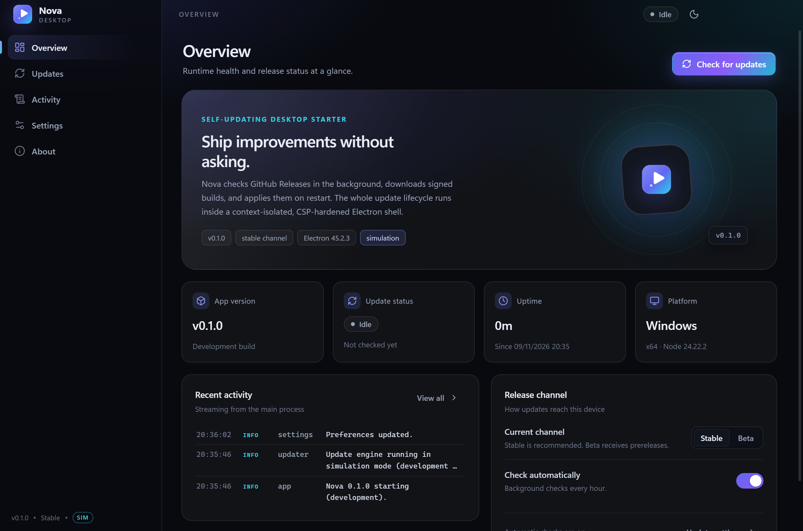
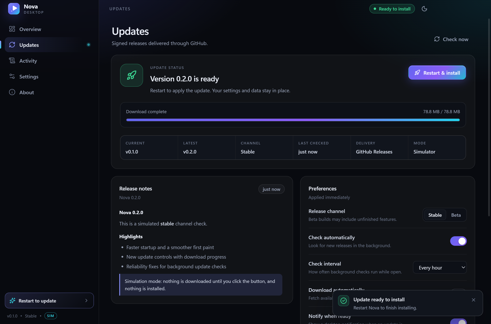

# Nova

A modern, self-updating Windows desktop starter built with **Electron + React + TypeScript**.
It ships with a polished light/dark UI, typed IPC, persisted preferences, window-state restore,
live logs, and a complete **GitHub Releases auto-update pipeline** via `electron-updater`.

Use it as the shell for your own product: replace the pages, keep the update machinery.

<p align="center">
  
  
</p>

---

## Highlights

- **Real auto-updates** — background checks, download progress, restart-to-install, release notes,
  stable/beta channels, desktop notification when an update is ready.
- **Update simulator** — click through the entire update UX in development before publishing anything.
- **Secure by default** — `contextIsolation`, `sandbox`, no `nodeIntegration`, strict CSP,
  blocked popups/navigation, external links handed to the OS browser, denied web permissions.
- **Native feel** — custom title bar overlay that follows the theme, single-instance lock,
  window size/position restore, launch-at-sign-in, start-minimized.
- **Included diagnostics** — main-process logger with rotation, live log stream, copy/open logs.
- **Installer ready** — NSIS installer, desktop shortcut, differential updates, GitHub Actions release workflow.

---

## Requirements

- **Windows 10/11** (the configured build target is NSIS x64)
- **Node.js ≥ 22.12** and npm
- A **GitHub repository** for release hosting

## Quick start

```bash
npm install
npm run dev
```

If Electron's binary was skipped during install (common behind corporate proxies), run:

```bash
node node_modules/electron/install.js
```

Build a production bundle and installer:

```bash
npm run build      # typecheck + bundle to out/
npm run dist       # NSIS installer → release/Nova-Setup-<version>.exe
npm run dist:dir   # unpacked app only → release/win-unpacked/Nova.exe
```

---

## Project structure

```
src/
  main/            Electron main process
    index.ts       app bootstrap, single instance, lifecycle
    window.ts      BrowserWindow, title bar overlay, window-state persistence
    ipc.ts         typed IPC handlers and settings side effects
    updater.ts     update state machine (real + simulated)
    security.ts    CSP, navigation/webview/popup hardening
    logger.ts      rotating file log + live IPC stream
    store.ts       atomic JSON store for settings/window state
  preload/         contextBridge API (window.api)
  shared/          types, IPC channel names, defaults/normalization
  renderer/        React UI
    src/pages/     Overview, Updates, Activity, Settings, About
    src/components/ design-system components
    src/styles.css  the full design system (no CSS framework)
scripts/
  make-icons.mjs   dependency-free PNG/ICO generator
build/             generated app icon (icon.png, icon.ico)
.github/workflows/ tag-triggered release workflow
electron-builder.yml
electron.vite.config.ts
```

### Scripts

| Script | What it does |
| --- | --- |
| `npm run dev` | Vite dev server + Electron with HMR |
| `npm run build` | Typecheck (node + web) and bundle to `out/` |
| `npm run start` | Preview the production bundle |
| `npm run typecheck` | TypeScript only, no emit |
| `npm run icons` | Regenerate `build/icon.png` / `build/icon.ico` |
| `npm run dist:dir` | Unpacked Windows app |
| `npm run dist` | NSIS installer |
| `npm run release` | Build and publish to GitHub (`GH_TOKEN` required) |

---

## How updates work

1. On launch (packaged builds) the app waits ~20 seconds, then checks GitHub Releases if
   automatic checks are enabled.
2. `electron-updater` reads `latest.yml` (stable) or `beta.yml` (beta) from the newest release.
3. If a newer version exists, the UI shows release notes. With **Download automatically** enabled
   it downloads without asking; otherwise the user clicks **Download update**.
4. When the download finishes the app shows a notification and a **Restart & install** button.
   Installed-on-quit is also enabled, so the update applies on the next normal restart.
5. Settings, window state and logs live in `%APPDATA%\Nova` and survive updates.

The update state machine (`src/main/updater.ts`) is the single source of truth; the renderer only
receives serializable state over IPC.

### Try the whole flow without publishing

```bash
npm run dev
```

Development builds automatically run the **simulator** (`!app.isPackaged`). Open **Updates** and
click **Check now** → **Download update** → **Restart & install** to see every state, including
download progress and the toast/notification.

To force simulation in a packaged build:

```powershell
$env:NOVA_UPDATE_SIM = "1"
.\release\win-unpacked\Nova.exe
```

The sidebar shows a `SIM` badge whenever the simulator is active.

---

## Publishing updates

### 1. Point the app at your repository

Replace the placeholders in **`electron-builder.yml`**:

```yaml
publish:
  provider: github
  owner: your-github-username   # ← your GitHub user or org
  repo: nova-desktop            # ← your repository name
  releaseType: release
```

Also update the link on the About page in
**`src/renderer/src/pages/AboutPage.tsx`** (`REPO_URL`).

> `app-update.yml` is generated inside the packaged app from this config. Changing the repository
> requires rebuilding the app.

The default setup assumes a **public** repository. For a private repository, electron-updater needs
credentials at runtime; keep the repository public unless you add a token strategy.

### 2. Bump the version

`electron-updater` compares semantic versions, so every release needs a higher version in
**`package.json`**:

- Stable: `0.1.0` → `0.1.1` (or `0.2.0`)
- Beta: `0.2.0-beta.1` → `0.2.0-beta.2`

### 3. Publish

**Option A — GitHub Actions (recommended).** Commit the version bump, then push a matching tag:

```bash
git tag v0.1.1
git push origin main --tags
```

`.github/workflows/release.yml` verifies the tag matches `package.json`, builds on `windows-latest`,
and publishes the installer plus update manifests. Stable versions publish `latest.yml`; versions
with a pre-release suffix publish as GitHub pre-releases with `beta.yml`.

**Option B — from your machine.** Create a GitHub token with `repo` scope (classic) or
Contents: Read/Write (fine-grained), then:

```powershell
$env:GH_TOKEN = "ghp_..."
npm run release
```

For a beta release locally:

```powershell
$env:GH_TOKEN = "ghp_..."
$env:EP_PRE_RELEASE = "true"
npm run build
npx electron-builder --win --publish always --config.publish.channel=beta
```

### 4. Verify

The release should contain:

```
Nova-Setup-0.1.1.exe
Nova-Setup-0.1.1.exe.blockmap
latest.yml          # stable
```

Installed clients discover it on their next check — no download link needed.

### Release channels

| Channel | Manifest | GitHub release | Updater |
| --- | --- | --- | --- |
| Stable | `latest.yml` | normal release | `allowPrerelease = false` |
| Beta | `beta.yml` | pre-release | `allowPrerelease = true`, `channel = "beta"` |

Users switch channels in **Settings → Updates** or **Updates → Preferences**.

---

## Code signing

Signing is optional for updates but strongly recommended: unsigned installers trigger SmartScreen
and make users distrust the update prompt.

1. Obtain a code-signing certificate (OV/EV, or a cloud signing service).
2. Export it as a password-protected `.pfx`.
3. Provide the certificate to electron-builder:

```powershell
$env:CSC_LINK = "C:\path\to\cert.pfx"      # or a base64-encoded value
$env:CSC_KEY_PASSWORD = "your-password"
npm run dist
```

In CI, add `CSC_LINK` and `CSC_KEY_PASSWORD` as repository secrets. The workflow already references
them (commented out). Once signing works, remove the "no code signing certificate" warnings.

---

## Security notes

- `contextIsolation: true`, `sandbox: true`, `nodeIntegration: false`, `webviewTag: false`.
- The renderer only touches a small, typed `window.api` surface exposed by the preload script.
- Strict CSP: production injects a `<meta>` policy at build time; development adds a header policy
  for the Vite dev server. `frame-ancestors` is only sent via headers because it is ignored in
  `<meta>`.
- All permission requests are denied; navigation away from the app is blocked; `http(s)` links open
  in the default browser; new windows and webviews are denied.
- Settings input is normalized in the main process before persistence, so a compromised renderer
  cannot inject arbitrary values.
- IPC handlers validate their arguments (path kinds, string lengths).

If you add remote content, keep it out of the privileged renderer or use a sandboxed `<webview>`
with its own policy.

---

## Renaming the app

The starter is branded **Nova**. To rename it, update these places:

| What | Where |
| --- | --- |
| Package + product name | `package.json` (`name`, `productName`) |
| App ID (Windows notifications/taskbar) | `electron-builder.yml` (`appId`) and `APP_ID` in `src/main/index.ts` |
| Window title | `title: 'Nova'` in `src/main/window.ts` |
| UI brand text | `src/renderer/src/components/Sidebar.tsx`, `Logo.tsx` (`aria-label`), pages' copy |
| HTML title | `src/renderer/index.html` |
| Icons | `scripts/make-icons.mjs`, then `npm run icons` |
| Repository links | `electron-builder.yml` publish block, `AboutPage.tsx` |
| Copyright | `electron-builder.yml`, `LICENSE`, About footer |

Keep `appId` stable after the first release so Windows treats updates as the same application.

---

## Troubleshooting

**`electron.exe` not found / `npm run dev` fails immediately**
Run `node node_modules/electron/install.js`, then retry.

**“Cannot find latest.yml” or a 404 during update checks**
The packaged `owner`/`repo` does not match the repository that has releases, the release is still a
draft, or the repo is private. Rebuild after fixing `electron-builder.yml`.

**Update check fails only in development**
That is expected — development uses the simulator. Use a packaged build to test real downloads.

**`EPIPE: broken pipe` in the console**
Harmless and handled. It happens when Electron's stdout pipe closes (for example, the launching
terminal exits). Logging falls back to the file and stops writing to the dead pipe.

**Windows SmartScreen warns about the installer**
Expected for unsigned builds. Add code signing (above).

**Installer cannot replace files**
Quit the running app first. The NSIS installer closes it automatically in most cases, but a
leftover process will block the executable.

**Users are stuck on an old version**
Confirm the version in `package.json` was bumped and the new release contains a newer manifest.
A version equal to or lower than the installed one is ignored by design (`allowDowngrade = false`).

**Where is everything stored?**

```
%APPDATA%\Nova\
  settings.json
  window-state.json
  logs\main.log        (rotates to main.old.log at 2 MB)
```

The exact paths are shown in **Settings → Storage** and **About**.

---

## License

MIT © 2026 Nova. See [LICENSE](LICENSE).
